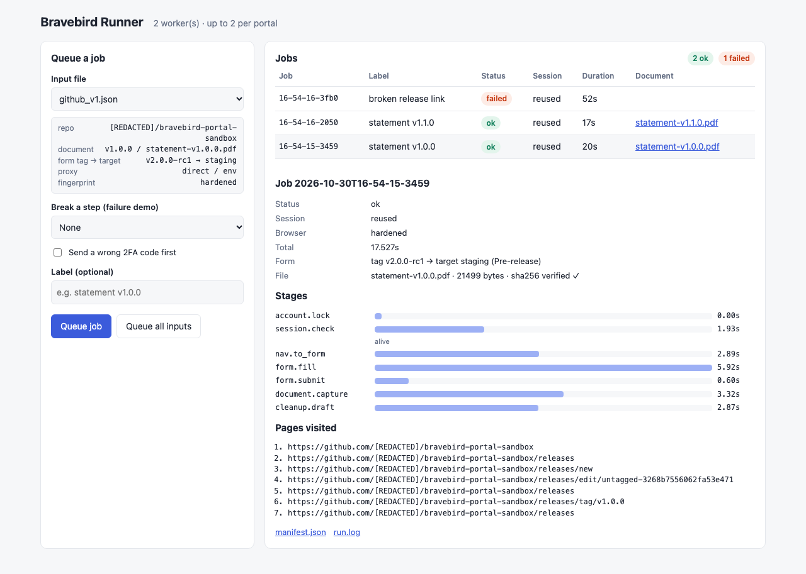
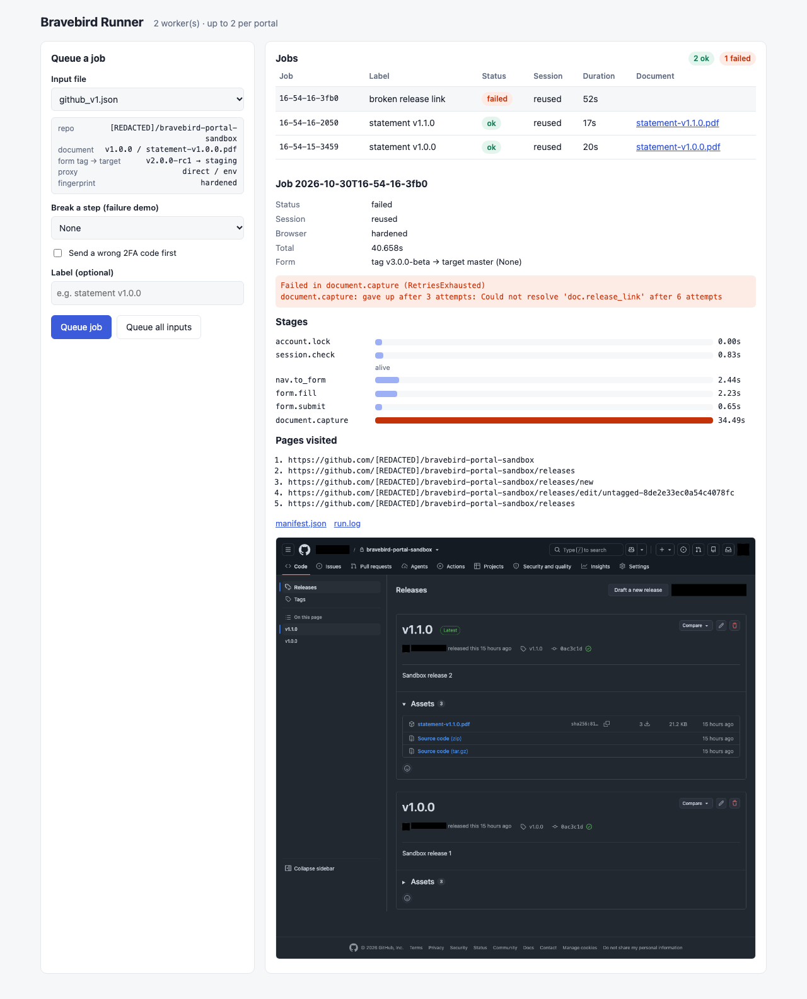

# Bravebird Automation Task

A single-process Playwright CLI that:

1. logs into **GitHub** with a password and a **TOTP second factor** (no human types the code),
2. **reuses the saved session** on later runs and falls back to a full login when it is dead,
3. clicks **three pages deep** (repo → Releases → Draft a new release) to a **5-field form with a
   dependent field**, fills it and saves a draft,
4. captures a **document via native download** (a release asset PDF) and verifies its sha256,
5. writes a **JSON manifest** of inputs, pages visited, stage timings and captured files.

All inputs come from a JSON file; a different release, document or form value needs no code change.

On top of that (extra credit): a **durable job queue + HTTP API + web UI**, **several runs at
once** with a per-account login lock, **proxy routing**, a **hardened browser fingerprint**, and
**CAPTCHA detection with a human-in-the-loop** path. See [Extra credit](#extra-credit).

## Status

| Requirement | State |
|---|---|
| 1. Second-factor login, code obtained automatically | ✅ TOTP, wrong-code retry verified live |
| 2. Session reuse + fallback to full login | ✅ Reuse, corrupted cookies and unreadable file verified live |
| 3. ≥ 3 pages deep to a form with ≥ 3 fields, one dependent | ✅ 5 fields; Target only exists for a new tag |
| 4. Document capture | ✅ Native download, sha256 checked against the portal's digest |
| 5. JSON manifest | ✅ Written on success *and* failure |
| Resilient locators, offline | ✅ 5 pages × 8 mutation variants (incl. a copy rewrite), all found |
| Retry + evidence bundle | ✅ Bounded backoff, redacted bundle (see `examples/failure-bundle`) |
| ★ Job queue + API | ✅ SQLite-backed, crash-safe, FIFO; FastAPI; token auth off-localhost |
| ★ Several portals at once | ✅ Worker pool, per-portal cap, per-account login lock (verified live) |
| ★ Small UI | ✅ Queue jobs, live status, stage timeline, files, redacted evidence |
| ★ Proxy routing | ✅ Per input, named routes from env, or a default; tested via a fake proxy |
| ★ Fingerprint hardening | ✅ No `HeadlessChrome`/`webdriver`; UA, client hints and languages agree |
| ★ CAPTCHA handling | ✅ Detect → stop as `needs_human` with evidence, or wait for a human when headed |

**Portal:** GitHub (TOTP 2FA). One site covers everything.
**Test data:** private repo `Divyaansh313/bravebird-portal-sandbox`, branches `master` and `staging`,
releases `v1.0.0` and `v1.1.0` with one PDF each. Private, so nothing is reachable without logging in.
Reviewers create an identical one in their own account with `make sandbox`
(see [Run it against your own account](#run-it-against-your-own-account)).

## Requirements

| Tool | Version | Purpose |
|---|---|---|
| macOS / Linux | — | Tested on macOS 26 (Apple Silicon) |
| [uv](https://docs.astral.sh/uv/) | ≥ 0.13 | Python + dependency manager |
| Python | 3.12 | Runtime (uv installs it) |
| Chromium | Playwright-managed | The browser |
| [gh](https://cli.github.com/) (optional) | ≥ 2.100 | Only for publishing / sandbox setup |

Python dependencies are pinned in `uv.lock`: `playwright`, `pyotp`, `pydantic`, `python-dotenv`,
`fastapi`, `uvicorn`; dev: `pytest`, `pytest-asyncio`, `ruff`, `httpx`.

## Setup (one command)

```bash
# once, if you don't have uv:
curl -LsSf https://astral.sh/uv/install.sh | sh && export PATH="$HOME/.local/bin:$PATH"

make setup        # = uv sync && uv run playwright install chromium, and creates .env (mode 600)
```

Then fill in `.env` (owner-only: it holds both login factors). Without `make`:
`uv sync && uv run playwright install chromium && cp .env.example .env && chmod 600 .env`.

## Environment variables

`.env` is git-ignored. See `.env.example`.

| Variable | Description |
|---|---|
| `PORTAL_USERNAME` | GitHub username or email of **your own** account |
| `PORTAL_PASSWORD` | Its password |
| `TOTP_SECRET` | Base32 TOTP secret: the "setup key" shown under the QR code when you add an authenticator app (Settings → Password and authentication) |
| `BRAVEBIRD_PROXY` | *Optional.* Default proxy, `scheme://[user:pass@]host:port` |
| `BRAVEBIRD_PROXY_<ROUTE>` | *Optional.* Named proxy route, picked per input with `"proxy_route": "<route>"` |
| `BRAVEBIRD_API_TOKEN` | *Optional.* Bearer token for the API; required if `bravebird-serve` listens beyond localhost |
| `BRAVEBIRD_LOCK_TIMEOUT` | *Optional.* Max seconds a run waits for another run's sign-in on the same account (default 300) |

## Run it against your own account

The committed `inputs/github_*.json` point at the author's private sandbox, which only the author
can sign in to. To run everything yourself, create the same sandbox in **your** account with one
command (needs the [GitHub CLI](https://cli.github.com) signed in as the account in your `.env`):

```bash
gh auth login                                         # once, same account as PORTAL_USERNAME
make sandbox                                          # = uv run python scripts/create_sandbox.py --yes
uv run bravebird --input inputs/local_v1.json         # then use the generated inputs
uv run bravebird --input inputs/local_v2.json         # different document, no code change
```

`make sandbox` creates a **private** repo `<you>/bravebird-portal-sandbox` with a `staging` branch
and releases `v1.0.0` and `v1.1.0`, each with a small generated PDF. It also writes
`inputs/local_v1.json` and `inputs/local_v2.json` (git-ignored) pointing at it, using your
account's real default branch. It's safe to re-run (anything that exists is kept), and
`--dry-run` shows the plan without changing anything. Remove it afterwards with
`gh repo delete <you>/bravebird-portal-sandbox` (needs `gh auth refresh -s delete_repo`).

Use `inputs/local_*.json` wherever this README says `inputs/github_*.json`; the `make run` /
`make run-v2` shortcuts use the author's files.

Why a script rather than making the author's sandbox public: the flow saves and deletes a draft
release, which needs **write** access, and public only grants read. A public repo would also let
anyone download the "statements" without logging in, and remove one of the dead-session signals
(a logged-out visitor gets 200 instead of 404).

## Usage

```bash
uv run bravebird --input inputs/github_v1.json                 # headless run
uv run bravebird --input inputs/github_v1.json --headed        # watch it
uv run bravebird --input inputs/github_v2.json                 # different document, no code change
uv run bravebird --input inputs/github_v1.json --simulate-wrong-code   # exercise the 2FA retry
uv run bravebird --input inputs/github_v1.json --break-step form.title # exercise the failure path

uv run bravebird-batch inputs/github_v1.json inputs/github_v2.json   # several at once
uv run bravebird-serve                                         # queue + API + UI on :8765

uv run pytest                                                  # 160 offline tests
uv run bravebird-offline check                                 # every fixture × every mutation
uv run bravebird-offline resolve --page form path/to/saved.html   # resolver on any saved HTML
uv run bravebird-offline mutate --all in.html out.html         # write a mutated copy
```

Exit codes: `0` success · `1` automation failure (evidence written) · `2` configuration error ·
`3` needs a human (CAPTCHA).
`--break-step` accepts any target key, e.g. `login.username`, `nav.releases`, `form.title`,
`form.target.open`, `doc.asset_link` (`--help` lists them all).

### Input JSON

```json
{
  "portal": "github",
  "base_url": "https://github.com",
  "repo": "Divyaansh313/bravebird-portal-sandbox",
  "form": {
    "tag": "v2.0.0-rc1",
    "target": "staging",
    "title": "Bravebird automated draft",
    "notes": "Drafted by the Bravebird automation run.",
    "label": "Pre-release"
  },
  "document": {
    "release_tag": "v1.0.0",
    "asset_name": "statement-v1.0.0.pdf"
  }
}
```

Optional: `form.keep_draft` (default `false`, the draft is deleted at the end), `headless`
(default `true`), `state_dir` (`state/`), `output_dir` (`runs/`), `proxy`
(`{"server", "username", "password", "bypass"}`), `proxy_route`, `fingerprint`
(`"hardened"` default, or `"default"`), `timezone` (IANA, e.g. `"Asia/Kolkata"`, to match a proxy's
region), `captcha_wait_seconds` (headed runs: wait this long for a human). Unknown keys are rejected
so a typo fails fast with exit code 2. `base_url` must be an `https://` origin (the password and
2FA code are typed there), `repo` must be a plain `owner/name`, and `portal` is `"github"`.

### Outputs

```
state/github.storage.json          saved session (cookies + localStorage), mode 600, git-ignored
                                   (state/ and runs/ are kept owner-only, 0700: they hold cookies,
                                   the job database and downloaded private documents)
runs/<timestamp>/run.log           redacted log
runs/<timestamp>/manifest.json     inputs, pages visited, stages + timings, files, retries, error
runs/<timestamp>/downloads/        captured document(s)
runs/<timestamp>/evidence/         only on failure: screenshot, page.html, url, console, failure.json
```

Committed samples: [`examples/successful-run/`](examples/successful-run) (first run from no saved
state) and [`examples/failure-bundle/`](examples/failure-bundle) (`--break-step doc.asset_link`).

## What a run does

| Stage | What happens |
|---|---|
| `account.lock` | Per-account lock so concurrent runs never sign in twice at once (see below) |
| `session.check` | Load saved state, open the private repo page, decide alive or dead |
| `login` | Only if no or dead session: username → password → TOTP (retry once) |
| `session.save` | Atomic write of storage state, mode 600 |
| `nav.to_form` | repo page → click **Releases** → click **Draft a new release** |
| `form.fill` | Tag (new) → **Target** branch (dependent) → Title → Description → Release label |
| `form.submit` | **Save draft**, which lands on `/releases/edit/untagged-…` |
| `document.capture` | Releases → click the release → click the asset → `download` event → sha256 check |
| `cleanup.draft` | Delete this run's draft through the confirmation dialog |

Measured live (see manifests): full login ≈ 17 s total, reused session ≈ 12 s total (auth stage
0.9 s instead of 3.7 s).

## Project layout

```
src/app/
  cli.py          `bravebird` and `bravebird-batch` entry points
  runner.py       Runner + execute(): one run, safe to run several concurrently
  jobs.py         durable SQLite job queue and worker pool
  api.py          FastAPI app + `bravebird-serve`
  ui/index.html   the web UI (no build step, no external requests)
  locks.py        per-account auth lock (asyncio + flock)
  fingerprint.py  hardened browser profile
  captcha.py      CAPTCHA detection and human-in-the-loop wait
  config.py       .env credentials + input JSON models (pydantic)
  otp.py          CodeProvider protocol, TotpProvider, wrong-code simulator
  session.py      save / load / discard browser state
  resolver.py     multi-strategy element resolver
  flows/github.py GitHub targets and steps (login, navigation, form, download, cleanup)
  retry.py        bounded exponential backoff, retryable vs final
  evidence.py     failure bundle, HTML scrubbing, masked screenshot
  manifest.py     run manifest
  redact.py       secret registry, logging filter, URL-token masking
  stages.py       stage keys and timings
  offline.py      `bravebird-offline`: resolver against saved HTML, mutations
  browser.py      browser lifecycle, console capture
tests/            offline tests; fixtures are sanitized copies of the real pages
scripts/          create_sandbox.py (your own test repo + inputs), sanitize_fixture.py
                  (turn a saved page into a safe fixture)
docs/             UI screenshots
inputs/           example input files
examples/         one successful run, one failure bundle
```

## Design answers

### How the code arrives, and what happens when it is wrong

The flow depends only on `async def get_code(challenge) -> str` (`src/app/otp.py`). The real
implementation, `TotpProvider`, computes RFC 6238 codes from `TOTP_SECRET` with `pyotp`, so there is
no human and no inbox to poll. An IMAP or SMS provider would be another class with the same method.

- If the current 30 s window has under 3 s left, it waits for the next window so the code doesn't
  expire in transit.
- GitHub auto-submits on the 6th digit. The flow waits for that form navigation; if none happens
  it clicks **Verify**. Because it waits for a fresh page load, a "failed" message left over from
  the previous attempt can't be mistaken for this attempt's result.
- **Wrong code → exactly one retry.** The provider never hands out the same code twice: if the
  current window's code was already sent and rejected, it waits for the next window (up to 30 s).
  A second rejection raises `TwoFactorError`, a final failure, so we never hammer the account into
  a lockout.
- If GitHub shows a passkey or GitHub Mobile prompt first, the flow switches to the authenticator app.
- **Never logged.** Each code is registered with the redactor when created, so it is masked
  anywhere. As a backstop for codes we didn't generate (e.g. one shown on a page), a 6–8 digit
  number is also masked when code-like words come just before it ("verification code is …",
  `otp=…`). Other numbers (order ids, amounts, file sizes) are left readable.

`--simulate-wrong-code` proves it live: *rejected on attempt 1 → real code → accepted on attempt 2*.
The simulator sends a wrong code without using up the real one, so the retry doesn't wait for a new
window (login 4.2 s in the verified run).

### How a dead session is detected

Not by "did we get redirected to `/login`". After loading saved state the run opens the **private
sandbox repo** and requires **both**:

1. `<meta name="user-login">` is filled. GitHub renders it only for a signed-in user, whatever the URL.
2. The response is **200**. Logged out, a private repo is a **404**, not a redirect.

Outcomes:

- **No signed-in user** → dead. (Live, with scrambled cookies GitHub answered 200 rather than 404,
  so the signed-in check is the one that catches it.)
- **Signed in but 404** → the session is fine and the `repo` input is wrong: a final input error.
  The working session is kept rather than thrown away for a login that couldn't help.
- **Signed in, 5xx** → retried (the check has 2 attempts).

- **Missing, unreadable or wrong-shape state file** (including JSON that parses but that Playwright
  would refuse, such as a cookie without a name) → treated as absent → full login.
- **Valid file, dead cookies** (tested by scrambling every cookie value) → detected → cookies
  cleared from the browser, state file deleted, full login, new state saved. Clearing matters:
  with garbage cookies still present, GitHub served a page without the login form.
- State is written atomically (temp file + rename), created with mode `600` from the start, in a
  `700` directory.

This check also makes reuse faster: it happens on the page the flow needs next anyway.

### Locator strategy order, and why

Each element is a `Target` describing it several independent ways. `resolve()` tries them in this
order, searching the main frame and then every iframe, and logs which strategy won:

1. **Role + accessible name**: what assistive tech sees. It survives class renames, wrappers and
   reordering, because the accessibility tree is what GitHub keeps stable.
2. **Label / placeholder**: the text a user reads next to the field.
3. **Nearby text**: visible text followed by the element (generated XPath, not hand-written).
4. **Structure**: shape in the page, e.g. `section[id="release-<slug>"] button[data-show-dialog-id^="delete-release"]`.
5. **id / class**: last resort, because build tooling churns these the most (GitHub's classes
   are hashed, like `prc-Button-ButtonBase-9n-Xk`).

Each strategy is tried in every frame before the next strategy, so a role match inside an iframe
beats a class match in the main frame.

Rules that made it robust in practice:

- **Visible elements only.** GitHub's login page has a hidden honeypot input, and the form page
  has hidden status templates such as "Duplicate tag name". Counting hidden elements caused false
  failures during development.
- **Unique or keep looking.** A strategy matching several elements is recorded as *ambiguous* and
  the resolver moves on. Example: two drafts with the same title make the role match ambiguous, so
  the section-scoped structural selector wins and deletes the right one. An ambiguous match is
  used only if nothing unique turns up before the timeout.
- **Unanchored names for composite labels.** The Target control is `<summary><i>Target:</i>
  <span>master</span></summary>`. Reordering its children changes the name to "master Target:",
  so the name pattern matches "Target:" anywhere.
- **No early wins while the page loads.** A weak strategy (nearby text, structure, id/class) may
  not win while `document.readyState` isn't `complete`; the resolver waits up to 3 s for the
  semantic match to render. Found live: before this, a half-rendered repo page let "nearby text"
  pick the link *after* the word "Releases" instead of the Releases link itself.
- Every attempt (strategy, query, frame, result) is kept and written to `failure.json`.

**Offline proof:** `uv run bravebird-offline check` loads sanitized copies of all 5 pages the flow
touches, blocks all network, and applies **renamed classes**, **reordered siblings**, an **added
wrapper div**, an **iframe**, plus a **copy rewrite** ("relabel": every visible word becomes
"Item N" and `aria-label`/`title`/`placeholder` are removed). Each runs alone and in two
combinations (all structural changes; the copy rewrite with reorder + wrapper + iframe). Every
target is found in all 8 variants: **ALL FOUND**.

The copy rewrite matters because the other mutations never change accessible names, so `role`
always won and the fallbacks went untested. Under the copy rewrite only wording-independent
strategies can win, and the tests assert exactly that. It exposed three targets that depended on
visible text (the Tag and Target pickers and the release-label radio); they now also carry
structural hooks (`#tag-list` anchor button, the menu summary in the tag-state container, the
radio's submitted `value`). Across the matrix, role wins 70 lookups, structure 30, id/class 4.
Copy rewrite and renamed classes together remove both signals at once; that's a redesign, not a
mutation, so it isn't one of the variants. `tests/test_resolver_mutations.py` runs the same matrix
in pytest, plus a case where ids are renamed too (so `<label for>` breaks).

### Portal quirks handled

| Quirk | Where | How |
|---|---|---|
| **Dependent field** | Release form | The **Target** branch picker only exists after a *new* tag is created in the tag dialog. The flow creates the tag, waits for Target to appear, selects the branch, then waits until the control shows it. An existing tag hides Target (GitHub says "Duplicate tag name"), which is a final input error. |
| **Download event** | Release page | `expect_download` around the asset click. Saved under `downloads/`, sha256 compared with the digest GitHub shows; a mismatch is retried and then fails the run. The signed CDN URL is not recorded, because its query string is a bearer token. |
| **Modal dialogs** | Tag picker, "Create new tag", "Delete this release?" | Resolved by role inside the dialog and confirmed explicitly. |
| **iframe** | Resolver | Every frame is searched; proven by the iframe mutation. |
| **Auto-submitting 2FA field** | Login | Waits for the navigation the 6th digit triggers; falls back to Verify / Enter. |
| **Client-side widgets that ignore early clicks** | Tag picker | Waits for page load before the first click and re-clicks if the dialog hasn't opened within 3 s (seen live under concurrent load). |
| **Lagging list after a save** | Releases list | A just-saved draft can be missing from the list for a few seconds, so cleanup always loads a fresh list and reloads with backoff until the draft's own section appears. |
| **Menus that re-render while filtering** | Branch picker | Clicks the branch directly; filters only when it isn't listed, then lets the list settle. Pressing Escape after selecting cancels the choice, so we don't. |

### Which failures retry

| Retried (bounded: 3 attempts, 1 s → 2 s → 4 s backoff, ±30 % jitter, capped at 8 s) | Final, never retried |
|---|---|
| `ResolveError` (element not there yet) | `AuthError`: wrong password, unexpected device verification |
| Playwright timeouts and navigation errors | `TwoFactorError`: code rejected twice |
| Our own `RetryableError` (e.g. Target didn't update, download failed or its sha256 is wrong, GitHub 5xx on the session check) | `FinalInputError`: existing tag, unknown branch, repo not reachable |
| | `CaptchaRequired`: a CAPTCHA no human is available to solve (exit 3, job `needs_human`) |
| | `ConfigError`: missing env vars, invalid input JSON, unknown proxy route (exit 2) |

Retries are per stage, and each stage is safe to repeat: `session.check` (2 attempts) is a page
load, `form.fill` reloads a clean form, `form.submit` (2 attempts) first gives the previous click
10 s to land on the saved draft before clicking again, and `cleanup.draft` waits for the draft to
disappear from the list; a retry first checks whether the draft's edit page is already a 404. The
TOTP provider never sends the same code twice, even when a whole login is retried. When attempts
run out the error becomes `RetriesExhausted` (final). Any other exception (a bug) is caught too:
evidence bundle, `status: failed`, exit code 1, never a bare traceback.

On a final failure the run writes `runs/<id>/evidence/`:

- `screenshot.png`: full page with every input, avatar and account name painted over
- `page.html`: DOM snapshot, scrubbed of hidden input values, CSRF/analytics meta, field values,
  emails, account identifiers
- `url.txt`, `console.log`: redacted
- `failure.json`: stage key, error type, root cause, retryable flag, retry history, and the
  resolver's attempts for the element that failed

It then deletes the draft if this run already saved one, so a failed run leaves the sandbox clean
(this cleanup ignores `--break-step`, so even `--break-step cleanup.delete` leaves no draft), and
still writes `manifest.json` with `status: failed`.

**Redaction:** password, username, TOTP secret, every generated code, and the login handle and
display name read from the page after sign-in are all registered with one redactor. Every log line
(tracebacks included) and every file written goes through it, along with masking for 6–8 digit
numbers next to code-like words and signed-URL tokens (`sig`, `jwt`, `token`, …). Evidence HTML
drops session-style `<meta>` values (any name containing nonce/token/hmac/csrf/session/payload),
whatever the attribute order or quoting. JSON is redacted value by
value, so numbers such as file sizes stay numbers and the output stays valid JSON. Before committing `examples/`, a scan for the real
credentials, session cookie values, CSRF tokens, signed-URL tokens and emails found nothing.

### What I'd change first for a hundred portals

1. **Portal definitions as data plus small plugins.** Today `flows/github.py` holds both targets
   and steps. I'd split each portal into a declarative target file (YAML/JSON) and a small step
   script, so most portals need no Python and target fixes don't need a deploy.
2. **A locator health loop.** Record which strategy won for each target on every run. When a target
   drifts from `role` down to `css`, flag it before it breaks, and auto-save the page as a new
   offline fixture.
3. **More code providers behind the same interface:** IMAP (with message-id dedupe), an SMS
   gateway webhook, and per-portal secrets in a vault instead of `.env`.
4. **Scale out the queue I built.** The SQLite queue, per-portal caps and account lock work on one
   machine. For a hundred portals I'd move jobs to Postgres (`SELECT … FOR UPDATE SKIP LOCKED`) or
   a broker, keep the account lock in the database instead of `flock`, add per-portal rate limits
   and schedules, and reuse warm browsers from a pool instead of launching one per job.
5. **Per-account session store** (encrypted, with TTL) instead of one local file, and a nightly
   canary run per portal that reports failures through the same evidence bundle.

## Extra credit

Everything below is optional per the brief and was only built after every core requirement passed.
All of it is covered by offline tests (`uv run pytest`: 160 tests) and was exercised live.

### Job queue + HTTP API

`uv run bravebird-serve` (or `make serve`) starts a FastAPI app on `127.0.0.1:8765` with a worker
pool in front of the same runner the CLI uses.

- **Durable:** jobs live in SQLite (`state/jobs.sqlite3`, mode 600). Jobs that were running when the
  process died are re-queued on start-up. Order is FIFO by insertion (not by timestamp, which has
  one-second resolution; caught by a test).
- **Isolated:** a crashing job is marked `failed` and the worker keeps going.
- **Statuses:** `queued → running → ok | failed | needs_human`, or `queued → cancelled`.
- **Endpoints:** `POST /api/jobs` (`{"input_file": "github_v1.json"}` or `{"input": {…}}`, optional
  `options.simulate_wrong_code` / `options.break_step`, `label`), `GET /api/jobs`,
  `GET /api/jobs/{id}`, `POST /api/jobs/{id}/cancel`, `GET /api/jobs/{id}/manifest`,
  `GET /api/jobs/{id}/log`, `GET /api/jobs/{id}/files/{name}`,
  `GET /api/jobs/{id}/evidence/screenshot.png`, `GET /api/health`, OpenAPI docs at `/api/docs`.

```bash
curl -X POST localhost:8765/api/jobs -H 'Content-Type: application/json' \
     -d '{"input_file": "github_v2.json", "label": "statement v1.1.0"}'
```

**API security** (the API can sign in to your account, so it is locked down by default):

- Binds to `127.0.0.1`. Any other host is refused unless `BRAVEBIRD_API_TOKEN` is set; the token is
  checked in constant time and redacted from logs. Without a token, requests must also carry a
  loopback `Host` header, so a web page can't reach the API through DNS rebinding.
- API jobs cannot set `state_dir`/`output_dir` (no writing elsewhere on disk) or `base_url` (where
  the password and 2FA code get typed), always run headless, and cannot carry an inline proxy
  password (use a named route instead).
- `input_file` must be a plain file name from `inputs/`; job ids are validated by pattern; file
  downloads only serve names listed in that job's result, resolved inside its run directory.
  Path-traversal attempts are covered by tests.
- All responses pass through the redactor, and the app registers the credentials itself, so it
  redacts even when embedded in another program.

### Small UI

`http://127.0.0.1:8765/`: pick an input file (with a preview of what it will do), optionally break a
step or send a wrong 2FA code, queue one job or every input at once. The job table refreshes live;
clicking a job shows its manifest: session mode, browser profile, form values, a stage timeline,
pages visited, the verified file, and for failures the error plus the redacted evidence screenshot.
One self-contained HTML file: no build step, no external requests, all output escaped, light and dark
themes, works at phone width.

| Successful job | Failed job (evidence) |
|---|---|
|  |  |

### Several portals at once

- `uv run bravebird-batch a.json b.json --concurrency 2`, or the API's worker pool
  (`--workers N --per-portal M`).
- Everything per-run is isolated: run ids carry a random suffix, each run's `run.log` contains only
  its own lines (log filter keyed on a context variable), and `--break-step` is per run.
- **Per-account login lock** (`locks.py`): two runs for the same account must not sign in at the
  same moment, because GitHub rejects a TOTP code that was already used, and they must not race on
  the state file. The lock (asyncio within a process, `flock` across processes) covers "load state
  → check → login → save" and is released before the slow part. The wait is bounded
  (`BRAVEBIRD_LOCK_TIMEOUT`, default 300 s; a login takes about 5 s), so a stuck run can't block
  others forever; a timeout is a retryable `LockTimeout`. **Verified live** with no saved
  session: run A signed in once, run B waited 5.1 s, loaded A's fresh session and skipped the login
  entirely. Both PDFs downloaded and verified in 20.7 s total.
- The worker pool caps jobs per portal so one portal can't take every worker (tested: two portals
  ran side by side while each stayed at its cap of 1).

### Proxy routing

Per run, in order: explicit `proxy` in the input → `proxy_route` (reads `BRAVEBIRD_PROXY_<ROUTE>`, so
credentials stay out of input files) → `BRAVEBIRD_PROXY` → direct. HTTP and SOCKS5 proxies,
optional bypass list, credentials registered with the redactor, proxy server recorded in the
manifest. An unknown route fails before any browser starts. Tested offline with a fake proxy that
serves pages itself and demands Basic auth, so the test proves traffic really goes through it.
`timezone` in the input lets the browser match the proxy's exit region.

### Fingerprint hardening

Default headless Chromium announces itself (`HeadlessChrome` in the user agent and client hints,
`navigator.webdriver === true`, languages that don't match `Accept-Language`). The `hardened` profile
(the default) runs the full Chromium build in new-headless mode and makes the user agent, client
hints, `navigator.languages` and the `Accept-Language` header agree, with `webdriver` false.
Client hints report Chromium and the machine's real OS version (read at runtime, not hard-coded). It does
**not** spoof hardware, canvas/WebGL or other devices: the goal is a consistent, honest browser for
automating your own accounts, not impersonation. A test probes both profiles on a secure origin and
checks every signal; `"fingerprint": "default"` turns it off.

### CAPTCHA handling

The runner never solves CAPTCHAs and never sends them to a solving service. `captcha.py` detects
reCAPTCHA, hCaptcha, Cloudflare Turnstile, Arkose and GitHub's octocaptcha (by frame URL and widget)
plus generic "verify you are human" pages, ignoring hidden widgets. It is checked after the password
step and whenever a stage fails, since a CAPTCHA otherwise looks like "element not found" and would
be retried pointlessly. Then either:

- **headless / no human:** stop with `CaptchaRequired` (final), evidence written, exit code `3`,
  job status `needs_human`; or
- **headed with `captcha_wait_seconds`:** wait for the person at the screen to solve it, then carry
  on.
